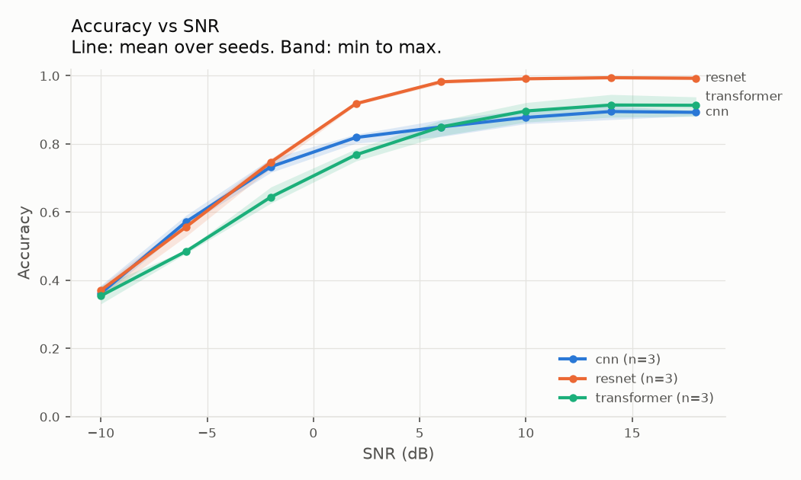

# What the RF

Modulation classifier for raw IQ samples, with a sim-to-real evaluation.

*Point it at a signal. Find out what the RF it is.*

Three models (CNN, ResNet, small transformer) are trained on synthetic or RadioML IQ data
and scored by one harness, which reports accuracy per SNR, per class and on real
captures from your own SDR. The headline question is how big the sim-to-real gap is and
how much each augmentation closes it. Each verdict comes with a plain-English
explanation built only from measured features and calibrated probabilities.

```
training data (synthetic, RadioML) ─▶ data layer (loaders, augment) ─▶ models ─▶ evaluation (reports/)
                                              ▲                          │
                                       windowed captures           probabilities
                                              │                          ▼
real capture (SigMF) ─────────────▶ features (bandwidth, SNR) ─▶ explanation ─▶ CLI + demo app
```

## Quickstart

```bash
uv venv --python 3.12 && uv pip install -e ".[dev,app]"
source .venv/bin/activate

wtrf train --config configs/cnn.yaml --eval     # Phase 1 gate: SNR curve + confusion in one command
wtrf synth --class WBFM --snr 8 --n 200 --out examples/wbfm
wtrf classify examples/wbfm.sigmf-meta          # top-3 classes with calibrated probabilities
wtrf explain examples/wbfm.sigmf-meta           # + explanation from measured features
streamlit run app/main.py                       # demo app
pytest                                          # ~5 s, no GPU, no downloads, no network
```

`device: auto` picks CUDA, then Apple MPS, then CPU. On an M-series Mac, MPS trains the
CNN about 14x faster than CPU.

## CLI

| Command | What it does |
|---|---|
| `wtrf train --config configs/cnn.yaml [--seeds 0 1 2] [--eval]` | Trains, writes `runs/<id>/` (config, checkpoint, per-epoch metrics) |
| `wtrf eval --run <id> [<id> ...] [--out dir]` | Full harness → `reports/`. Several runs = model comparison with seed spread |
| `wtrf ablate --config configs/phase3-cnn.yaml --seeds 0 1 2` | One run per augmentation (alone, then all), scored on real captures |
| `wtrf classify capture.sigmf-meta [--run <id>]` | Top classes with probabilities, plus measured features |
| `wtrf explain capture.sigmf-meta` | Classify, then explain the result from measured features |
| `wtrf synth --class QPSK --snr 10 --out x.npy` | Synthetic batch (`.npy`) or, for any other path, a SigMF capture |

`--run` defaults to `latest`.

## Repo layout

```
configs/            one YAML per experiment (model, data, augment, seed)
src/wtrf/
  data/             labels, synth, radioml, sigmf, augment, dataset (splits + shared format)
  models/           cnn, resnet, transformer, registry, train
  eval/             snr_curves, confusion, calibration, real_vs_synth, ablation, harness
  features.py       bandwidth, centre frequency, SNR estimate, spectrogram
  explain.py        plain-English explanation from probabilities and features
  pipeline.py       classify/explain a capture: the one path the CLI and app share
  cli.py
app/main.py         Streamlit demo
captures/           your real SigMF captures (test set only)
examples/           synthetic SigMF files for trying the CLI and app
scripts/            download_radioml.py
```

## Data

Every source becomes the same format: float32 IQ `(2, N)`, a class label and an SNR in dB.
Each example is scaled to unit RMS power, after augmentation too.

| Source | Used for | Notes |
|---|---|---|
| Synthetic (`data/synth.py`) | Training, SNR curves | NumPy, seeded. 8 samples/symbol, RRC (β=0.35) for PSK/QAM, so it matches RadioML 2016.10a |
| RadioML 2016.10a | Training baseline | CC BY-NC-SA 4.0. `python scripts/download_radioml.py --archive ...`, then `data.source: radioml`. Never committed |
| Real captures (SigMF) | Sim-to-real test only | Never used for training or tuning |

SNR always means signal power over noise power across the full sample bandwidth (the
RadioML convention). The feature extractor estimates it the same way, so a capture's
estimated SNR can be looked up on the SNR curve.

Splits are stratified by (class, SNR) with a fixed seed, before any augmentation. Real
captures are grouped by `wtrf:session`, so windows from one session never straddle splits
(`group_split`).

**Classes.** `data/labels.py` holds the only mapping between RadioML, synthetic and capture names.

| Taxonomy | Classes |
|---|---|
| `phase1` | BPSK, QPSK, 8PSK, QAM16, GFSK, AM-DSB, WBFM |
| `phase3` | WBFM (`fm_broadcast`), AFSK-FM (`aprs`), 8GFSK (`ft8`), OOK (`cw`) |

### Real captures

Store each capture as a SigMF pair in `captures/` with these fields:

```json
{
  "global": {
    "core:datatype": "cu8",
    "core:sample_rate": 2400000,
    "core:hw": "RTL-SDR Blog V4",
    "core:version": "1.0.0",
    "core:extensions": [{"name": "wtrf", "version": "0.1.0", "optional": true}],
    "wtrf:label": "aprs",
    "wtrf:session": "2026-11-05-dublin-roof",
    "wtrf:gain_db": 32.8,
    "wtrf:signal_offset_hz": 250000
  },
  "captures": [{"core:sample_start": 0, "core:frequency": 144550000, "core:datetime": "..."}],
  "annotations": []
}
```

`sigmf.write(...)` produces this for you. Supported datatypes: `cf32_le`, `ci16_le`, `ci8`, `cu8`.
At load time each capture is shifted by `wtrf:signal_offset_hz`, resampled to
`captures.target_rate` and cut into windows of `n_samples`. Record frequency, time,
gain and SDR for every capture: they decide the gap you are measuring.

Decide on a minimum number of sessions per class before Phase 3 (start with 5 sessions
of at least 30 s each). The window count goes next to every real-capture number in the reports.

## Models and training

All three map `(batch, 2, N)` to logits over the class list, so the harness never knows
which one it is scoring.

| Model | Shape |
|---|---|
| `cnn` | 4 conv blocks (conv, BN, ReLU, max-pool), global average pool, linear head |
| `resnet` | stem + 3 stages of 1D basic residual blocks, same head |
| `transformer` | 8-sample patches → 4-layer pre-norm encoder → mean pool → linear head |

Plain PyTorch loop: cross-entropy, AdamW, cosine schedule, validation accuracy per SNR
bucket every epoch. Every run saves its exact config and seed. After training, a single
temperature is fitted on the validation split (temperature scaling). "Calibrated
probabilities" everywhere means `softmax(logits / T)`.

Fairness rules: same data, split, augmentation and epoch budget for each model; parameter
count and training time sit next to accuracy; three seeds per model with the spread shown.

Tracking: metrics always go to `runs/<id>/metrics.jsonl`. Set `tracking: mlflow` and
`pip install -e ".[mlflow]"` to also log to MLflow. MLflow was picked over W&B because it
runs locally with no account.

## Evaluation

| Report | Question |
|---|---|
| `snr_curves.png/.csv` | How does accuracy fall as SNR drops? One line per model, band = seed spread |
| `confusion_{high,low}_<cfg>.png/.csv` | Which classes get mixed up, at high and low SNR? |
| `calibration_<cfg>.png/.csv` | Is confidence honest? Reliability diagram, ECE before/after temperature scaling |
| `real_vs_synth_<cfg>.png/.csv` | How big is the sim-to-real gap, per class? (written once `captures/` has data) |
| `ablation.png/.csv` | Which augmentation closes the gap? Recovery = share of the no-augmentation gap closed |
| `summary.md` | One table: params, train time, accuracy (mean ± std), ECE, real accuracy |

Every number comes with the count of windows behind it. The real-capture set is only
touched by `real_vs_synth` and `ablation`, and every model and ablation row uses the same set.

Augmentations (`data/augment.py`) run in a fixed order: multipath fading (Rayleigh,
exponential delay profile) → carrier frequency offset → sample clock drift → additive
noise at a random SNR.

## Explanation

`wtrf explain` adds a short, deterministic explanation to a classification
([explain.py](src/wtrf/explain.py)), built only from:

- the top 3 calibrated probabilities
- the measured centre frequency, occupied bandwidth, estimated SNR and duration
- the model's measured test accuracy at the nearest SNR, if `wtrf eval` has run

It returns a `verdict`, `evidence` bullets citing the measured values, a `confidence_note`
and `alternatives` (what would distinguish each runner-up). Below `explain.threshold`
(0.6 by default) the verdict and note say the result is uncertain. It names modulations,
never protocols or uses: an APRS capture is reported as AFSK-FM, because that is all the
classifier knows.

An earlier version put an LLM in this step. It was removed because it saw the same facts
as this template and couldn't change the verdict, so it only reworded the text, at the
cost of an API key, latency and guardrail code.

## Testing

`pytest` runs in about 5 seconds on a laptop CPU, with no dataset download and no network:
generator shapes and spectra per class, SigMF round-trips, label coverage, model output
shapes and a loss-decreasing step, bit-exact reproducibility on CPU, harness outputs,
calibration maths, and the explanation (low-confidence and out-of-distribution results
say "uncertain"; evidence cites measured values; no protocol names).

`tests/test_regression.py` checks a golden set of labelled real captures against a stored
accuracy floor. It skips until you freeze one: copy a few captures and a run into
`tests/golden/` and write `floor.json` (`{"run": "<run dir>", "floor": 0.8}`).

CI (GitHub Actions) runs ruff, mypy and pytest on every push, with CPU-only torch.

## Status

| Phase | Gate | State |
|---|---|---|
| 1. Baseline CNN | SNR curve + confusion from one command | Done (synthetic). RadioML runs with `data.source: radioml` once downloaded |
| 2. Better models | All three scored under the same rules, 3 seeds | Done (synthetic), results below |
| 3. Real captures | Real test set frozen, gap measured | Tooling ready; needs your FM, APRS, FT8 and CW captures |
| 4. Close the gap | Recovery per augmentation | `wtrf ablate` ready; needs Phase 3 captures |
| 5. Explanation | Low-confidence inputs hedge | Done; deterministic template (LLM layer removed) |
| 6. Demo | Upload a capture, get verdict + explanation | Done (CLI + Streamlit) |

## Results

### Phase 2: three models on synthetic data

Phase 1 classes, 128-sample windows, SNR −10 to +18 dB, 400 examples per class per SNR,
15 epochs. Three seeds per model, trained on Apple MPS (M-series). Test set: 3,360
windows (420 per SNR bucket). Reproduce with `wtrf train --config configs/<model>.yaml
--seeds 0 1 2`, then `wtrf eval --run runs/*`.

| Model | Params | Train time (s) | Accuracy (all SNR) | Acc @ +10 dB | Acc @ −6 dB | ECE raw → calibrated |
|---|---|---|---|---|---|---|
| CNN | 203,655 | 57 ± 3 | 75.0 ± 0.2 % | 87.8 ± 1.7 % | 57.1 ± 1.4 % | 0.048 → 0.031 |
| ResNet | 392,711 | 93 ± 1 | **81.9 ± 0.2 %** | **99.1 ± 0.3 %** | 55.6 ± 2.0 % | 0.036 → 0.022 |
| Transformer | 202,631 | 53 ± 6 | 72.8 ± 1.4 % | 89.7 ± 2.4 % | 48.5 ± 0.4 % | 0.035 → 0.031 |



- **ResNet wins clearly above 0 dB.** It separates QPSK from 8PSK, which the CNN can't:
  at +10 dB the CNN calls 42% of QPSK windows 8PSK, while the ResNet gets both to 98% or better.
  ([CNN confusion](docs/phase2_confusion_high_cnn.png),
  [ResNet confusion](docs/phase2_confusion_high_resnet.png))
- **The transformer doesn't beat the CNN overall.** It is slightly better at high SNR but
  worst below 0 dB, at the same parameter count. That's a result in its own right.
- **Below −6 dB all three converge**, which points to the data (16 symbols per window in
  noise) rather than the architecture as the limit.
- **Temperature scaling helps every model.** ECE drops 10 to 40%, so the reported
  probabilities can be taken roughly at face value.

These are synthetic-to-synthetic numbers. The sim-to-real gap (Phase 3) and RadioML
baselines come next.

## Known limitations and risks

- Synthetic phase 3 classes are simplified: AFSK-FM uses a 6:11 tone ratio and FT8-like
  8GFSK uses spacing equal to the symbol rate. Their bandwidths in cycles/sample only
  match real signals at a suitable `captures.target_rate`. Choosing that rate is part of
  Phase 3, and is itself a source of sim-to-real gap.
- The real set may be too small or too clean to show a gap. Count sessions, not windows.
- Real labels come from what you tuned to, so log frequency, time and settings for every capture.
- Feature SNR and bandwidth use a 20th-percentile noise floor, which degrades when a
  signal fills most of the window's bandwidth.
- Training is bit-exact across reruns on CPU only; MPS and CUDA runs are close but not identical.
- A transformer may not beat the CNN here. If it doesn't, that's a result worth reporting.

## License

MIT. See [LICENSE](LICENSE). RadioML 2016.10a is CC BY-NC-SA 4.0 and is not distributed with this repo.
